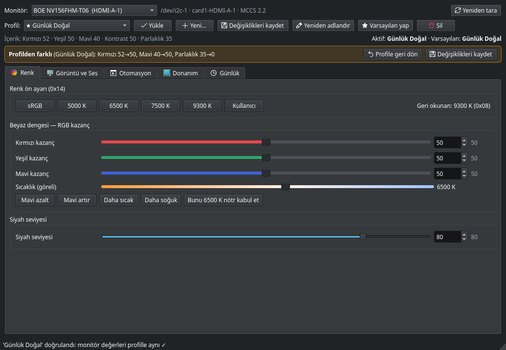
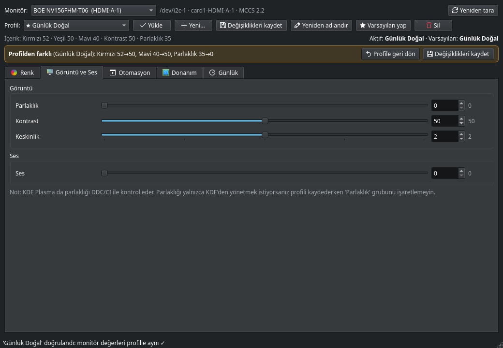
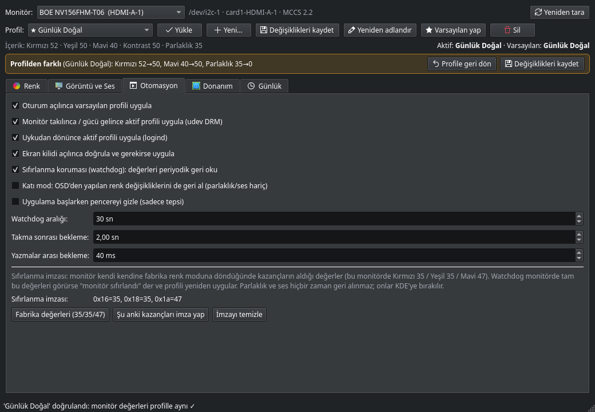
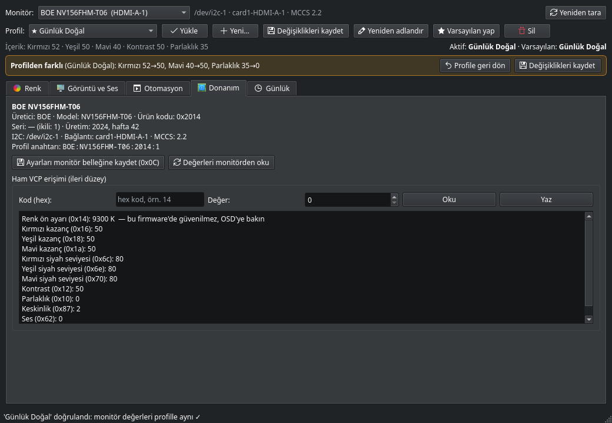
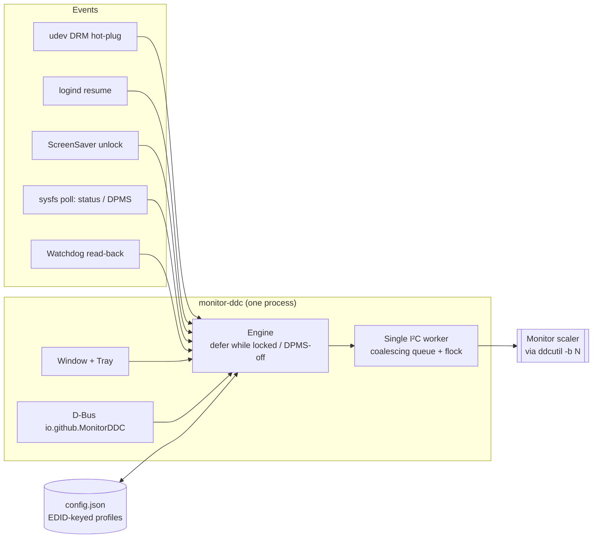

<div align="center">

# 🖥️ Monitor Control Studio · Monitör Kontrol Stüdyosu

**Hardware color, white-balance and brightness control for external monitors on Linux — over DDC/CI, with profiles that re-apply themselves.**

**Linux'ta harici monitörlerin rengini, beyaz dengesini ve parlaklığını DDC/CI üzerinden donanımsal olarak yönetin; profiller kendiliğinden yeniden uygulansın.**

[](LICENSE.md)


-41CD52?logo=qt&logoColor=white)


[**English**](#-english) · [**Türkçe**](#-türkçe) · [**Releases / Sürümler**](../../releases) · [**Security / Güvenlik**](SECURITY.md)


</div>

---

## 🇬🇧 English

### Why?

Many portable and budget monitors (especially the ones with **RealTek** scalers) **forget their color settings** every time they lose power, wake from sleep or get re-plugged. They come back in a cold, bluish 9300 K mode. Desktop environments let you change *brightness*, but there is no UI for the monitor's **hardware RGB gains, color presets or black level**.

Monitor Control Studio talks to the monitor's own image processor over **DDC/CI** (the I²C channel inside your HDMI/DisplayPort cable). This is exactly what the monitor's physical OSD buttons do, so you don't lose color depth the way a software filter (Night Light, Redshift) does. You save your settings as profiles, and the app **puts them back automatically** whenever the monitor resets itself.

### ✨ Features

| | |
|---|---|
| 🎨 **Live hardware controls** | RGB gain (white balance), black level, color preset, brightness, contrast, sharpness, speaker volume. Sliders write to the monitor in real time; the I²C queue coalesces drags so the UI never freezes. |
| 🌡️ **Relative color temperature** | A Kelvin slider that computes R/G/B gains from a black-body curve around *your* neutral point. |
| 💾 **Profiles** | Unlimited profiles bound to the monitor's EDID identity. Partial profiles: leave brightness out and it stays under your desktop's control. A **"differs from profile"** bar with *Revert* / *Save changes*. |
| 🔌 **Auto re-apply** | On login, cable/power hot-plug (udev DRM), resume from sleep (logind) and screen unlock. Waits until the monitor's scaler is actually ready instead of using a fixed delay. |
| 🛡️ **Reset watchdog** | Periodically reads the gains back. If the monitor has fallen back to its factory signature (e.g. 35/35/47), only the broken color values are fixed. Brightness and volume are **never** fought over: they belong to your desktop. |
| 🌙 **Gentle on hardware** | No DDC traffic while the screen is locked or the output is in DPMS-off, so a sleeping monitor is not woken into a "No signal" screen. Monitors are discovered from `/sys/class/drm` (no I²C probing). The internal laptop panel's bus is **never touched**, which avoids Intel PSR flicker. |
| 🧰 **Tray + CLI + D-Bus** | Switch profiles from the system tray, script with `monitor-ddc --apply "Night"`, or call `io.github.MonitorDDC` over D-Bus. |
| 🔒 **Hardened** | Sandboxed systemd user service (exposure **1.4 OK**), validated inputs everywhere, 140 automated tests including fuzzing. See [SECURITY.md](SECURITY.md). |

### 📸 Screenshots

| Color & white balance | Picture & audio |
|---|---|
|  |  |
| **Automation** | **Hardware / raw VCP** |
|  |  |

> The interface is currently in Turkish; translations are welcome.

### 📦 Installation

**Requirements:** Linux, Python ≥ 3.11, [ddcutil](https://www.ddcutil.com/) ≥ 2.0, PySide6 ≥ 6.5, a monitor with DDC/CI enabled in its OSD. It is developed on KDE Plasma 6 (Wayland) and works on any desktop with a system tray.

```bash
# Arch / CachyOS / Manjaro
sudo pacman -S ddcutil pyside6
# Fedora
sudo dnf install ddcutil python3-pyside6
# Debian / Ubuntu (24.10+)
sudo apt install ddcutil python3-pyside6.qtwidgets python3-pyside6.qtdbus
```

```bash
git clone https://github.com/OnruBekrant/monitor-control-studio.git
cd monitor-control-studio
./install.sh              # user-level install: ~/.local/bin, systemd --user service, app menu entry
./install.sh --uninstall  # remove (your profiles in ~/.config/monitor-ddc are kept)
```

If `ddcutil detect` reports a permission error, load the `i2c-dev` module and give your user access to `/dev/i2c-*`. Most distro `ddcutil` packages already do this; otherwise run `sudo usermod -aG i2c $USER` and log in again.

### 🚀 Usage

| Command | What it does |
|---|---|
| `monitor-ddc` | Open the window (or raise the running instance) |
| `monitor-ddc --apply "Night"` | Apply a profile |
| `monitor-ddc --reapply` | Re-apply the active profile |
| `monitor-ddc --list` | List monitors and their profiles |
| `journalctl --user -u monitor-ddc -f` | Follow the service log |

Profiles and settings live in `~/.config/monitor-ddc/config.json`.

### ⚙️ How it works



* **One process, one I²C owner.** The GUI, tray and automation share a process. All bus traffic goes through one worker thread and a cross-process lock, so nothing races on the wire. Concurrent DDC packets can make cheap scalers fall back to factory colors.
* **One feature per `setvcp`.** Some RealTek firmwares silently drop the last value of a multi-value write.
* **The color-preset read-back (VCP 0x14) is not trusted.** On some firmwares it reports a different preset than the one written, so it is never used for verification.

### 🧪 Development & tests

```bash
python3 -m venv --system-site-packages .venv && .venv/bin/pip install -r requirements-dev.txt
python3 -m venv .venv-semgrep && .venv-semgrep/bin/pip install -r requirements-semgrep.txt
scripts/check.sh          # ruff, mypy, bandit, semgrep, detect-secrets, pip-audit, shellcheck, systemd, pytest
scripts/check.sh --live   # + integration tests against a real monitor
```

The unit and module tests use a **fake `ddcutil`** and a **fake sysfs tree**, so they run anywhere, including CI, without a monitor.

### 📜 License

[**PolyForm Noncommercial 1.0.0**](LICENSE.md). In plain words (this summary is not legal advice; the license text is what counts):

* ✅ **Use** it for free: personal use, study, hobby projects, research, schools, charities, public institutions.
* ✅ **Modify** it, fork it and share your changes, as long as you pass the license along.
* ❌ **No commercial use**: you may not sell it, bundle it into a paid product or use it for commercial advantage.

For commercial licensing, please open an issue.

Third-party software: **PySide6 / Qt** (LGPLv3) is used as an unmodified, dynamically loaded system library. **ddcutil** (GPLv2) is invoked as a separate program. Neither is bundled.

---

## 🇹🇷 Türkçe

### Neden?

Pek çok taşınabilir ve uygun fiyatlı monitör (özellikle **RealTek** kontrolcülü olanlar) gücü kesildiğinde, uykudan döndüğünde ya da kablosu çıkarılıp takıldığında **renk ayarlarını unutur**. Soğuk, mavimsi 9300 K moduyla geri gelir. Masaüstü ortamları *parlaklığı* değiştirmenize izin verir, ama monitörün **donanımsal RGB kazançları, renk ön ayarları ve siyah seviyesi** için bir arayüz yoktur.

Monitör Kontrol Stüdyosu, monitörün kendi görüntü işlemcisiyle **DDC/CI** üzerinden konuşur; bu, HDMI/DisplayPort kablosunun içindeki I²C hattıdır. Yaptığı şey, monitörün fiziksel OSD tuşlarının yaptığıyla birebir aynıdır. Bu yüzden Gece Işığı veya Redshift gibi yazılımsal filtrelerde olduğu gibi renk derinliği kaybolmaz. Ayarlarınızı profil olarak kaydedersiniz; monitör kendini sıfırladığında uygulama onları **kendiliğinden geri yükler**.

### ✨ Özellikler

| | |
|---|---|
| 🎨 **Canlı donanım kontrolleri** | RGB kazanç (beyaz dengesi), siyah seviyesi, renk ön ayarı, parlaklık, kontrast, keskinlik, hoparlör sesi. Kaydırıcılar monitöre anında yazar; I²C kuyruğu sürüklemeleri birleştirir, arayüz donmaz. |
| 🌡️ **Göreli renk sıcaklığı** | *Sizin* nötr noktanızı merkez alan, R/G/B kazançlarını kara cisim eğrisinden hesaplayan bir Kelvin kaydırıcısı. |
| 💾 **Profiller** | Monitörün EDID kimliğine bağlı, sınırsız profil. Kısmi profiller: parlaklığı profile koymazsanız masaüstünüzün kontrolünde kalır. **"Profilden farklı"** şeridi ile *Profile geri dön* / *Değişiklikleri kaydet*. |
| 🔌 **Otomatik yeniden uygulama** | Oturum açılışı, kablo/güç takılması (udev DRM), uykudan dönüş (logind) ve ekran kilidinin açılması. Sabit süre beklemek yerine monitörün kontrolcüsü gerçekten hazır olana kadar bekler. |
| 🛡️ **Sıfırlanma koruması** | Kazançları periyodik olarak geri okur. Monitör fabrika imzasına (örn. 35/35/47) döndüyse yalnızca bozulan renk değerlerini düzeltir. Parlaklık ve sesle **asla** inatlaşmaz; onlar masaüstünüzündür. |
| 🌙 **Donanıma nazik** | Ekran kilitliyken ya da çıkış DPMS-Off'tayken DDC trafiği göndermez; böylece uyuyan monitör "Sinyal yok" ekranına uyandırılmaz. Monitörleri `/sys/class/drm` üzerinden bulur (I²C taraması yok). Dizüstünün dahili panelinin hattına **hiç dokunmaz**; bu da Intel PSR titremesini önler. |
| 🧰 **Tepsi + CLI + D-Bus** | Profilleri sistem tepsisinden değiştirin, `monitor-ddc --apply "Gece"` ile betik yazın ya da D-Bus üzerinden `io.github.MonitorDDC` çağırın. |
| 🔒 **Sertleştirilmiş** | Sandbox'lı systemd kullanıcı servisi (exposure **1.4 OK**), her yerde doğrulanan girdiler, fuzz dahil 140 otomatik test. Bkz. [SECURITY.md](SECURITY.md). |

### 📸 Ekran görüntüleri

| Renk ve beyaz dengesi | Görüntü ve ses |
|---|---|
|  |  |
| **Otomasyon** | **Donanım / ham VCP** |
|  |  |

### 📦 Kurulum

**Gereksinimler:** Linux, Python ≥ 3.11, [ddcutil](https://www.ddcutil.com/) ≥ 2.0, PySide6 ≥ 6.5 ve OSD menüsünde DDC/CI'ı açık bir monitör. KDE Plasma 6 (Wayland) üzerinde geliştirildi; sistem tepsisi olan her masaüstünde çalışır.

```bash
# Arch / CachyOS / Manjaro
sudo pacman -S ddcutil pyside6
# Fedora
sudo dnf install ddcutil python3-pyside6
# Debian / Ubuntu (24.10+)
sudo apt install ddcutil python3-pyside6.qtwidgets python3-pyside6.qtdbus
```

```bash
git clone https://github.com/OnruBekrant/monitor-control-studio.git
cd monitor-control-studio
./install.sh              # kullanıcı düzeyinde kurulum: ~/.local/bin, systemd --user servisi, menü girdisi
./install.sh --uninstall  # kaldır (~/.config/monitor-ddc içindeki profilleriniz kalır)
```

`ddcutil detect` izin hatası verirse `i2c-dev` modülünü yükleyin ve kullanıcınıza `/dev/i2c-*` erişimi verin. Çoğu dağıtımın `ddcutil` paketi bunu zaten yapar; yapmıyorsa `sudo usermod -aG i2c $USER` çalıştırıp oturumu yeniden açın.

### 🚀 Kullanım

| Komut | Ne yapar |
|---|---|
| `monitor-ddc` | Pencereyi açar (çalışıyorsa öne getirir) |
| `monitor-ddc --apply "Gece"` | Profili uygular |
| `monitor-ddc --reapply` | Aktif profili yeniden uygular |
| `monitor-ddc --list` | Monitörleri ve profilleri listeler |
| `journalctl --user -u monitor-ddc -f` | Servis günlüğünü izler |

Profiller ve ayarlar `~/.config/monitor-ddc/config.json` dosyasında tutulur.

### ⚙️ Nasıl çalışır?

* **Tek süreç, tek I²C sahibi.** Arayüz, tepsi ve otomasyon aynı süreçtedir. Tüm hat trafiği tek bir işçi iş parçacığından ve süreçler arası bir kilitten geçer, böylece hatta yarış olmaz. Eşzamanlı DDC paketleri ucuz kontrolcüleri fabrika renklerine düşürebiliyor.
* **Her `setvcp` tek bir özellik yazar.** Bazı RealTek firmware'leri çok değerli bir yazmada son değeri sessizce kaybediyor.
* **Renk ön ayarının (VCP 0x14) geri okumasına güvenilmez.** Bazı firmware'ler yazılandan farklı bir ön ayar bildirdiği için doğrulamada hiç kullanılmaz.

Mimari diyagramı için İngilizce bölümdeki *How it works* kısmına bakabilirsiniz.

### 🧪 Geliştirme ve testler

```bash
python3 -m venv --system-site-packages .venv && .venv/bin/pip install -r requirements-dev.txt
python3 -m venv .venv-semgrep && .venv-semgrep/bin/pip install -r requirements-semgrep.txt
scripts/check.sh          # ruff, mypy, bandit, semgrep, detect-secrets, pip-audit, shellcheck, systemd, pytest
scripts/check.sh --live   # + gerçek monitörde entegrasyon testleri
```

Birim ve modül testleri **sahte bir `ddcutil`** ve **sahte bir sysfs ağacı** kullanır; bu yüzden monitör olmadan her yerde (CI dahil) çalışır.

### 📜 Lisans

[**PolyForm Noncommercial 1.0.0**](LICENSE.md). Kısaca (bu özet hukuki tavsiye değildir; geçerli olan lisans metnidir):

* ✅ **Ücretsiz kullanın**: kişisel kullanım, öğrenme, hobi projeleri, araştırma, okullar, hayır kurumları, kamu kurumları.
* ✅ **Değiştirin**, çatallayın (fork) ve değişikliklerinizi paylaşın; lisansı da birlikte iletmeniz yeterli.
* ❌ **Ticari kullanım yok**: satamaz, ücretli bir ürüne katamaz ya da ticari kazanç için kullanamazsınız.

Ticari lisans için lütfen bir issue açın.

Üçüncü taraf yazılımlar: **PySide6 / Qt** (LGPLv3), değiştirilmemiş ve dinamik yüklenen bir sistem kütüphanesi olarak kullanılır. **ddcutil** (GPLv2) ayrı bir program olarak çağrılır. İkisi de projeyle birlikte paketlenmez.
